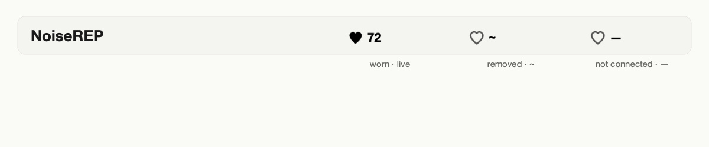
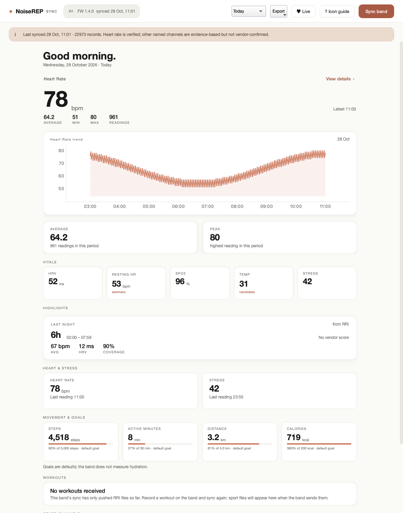
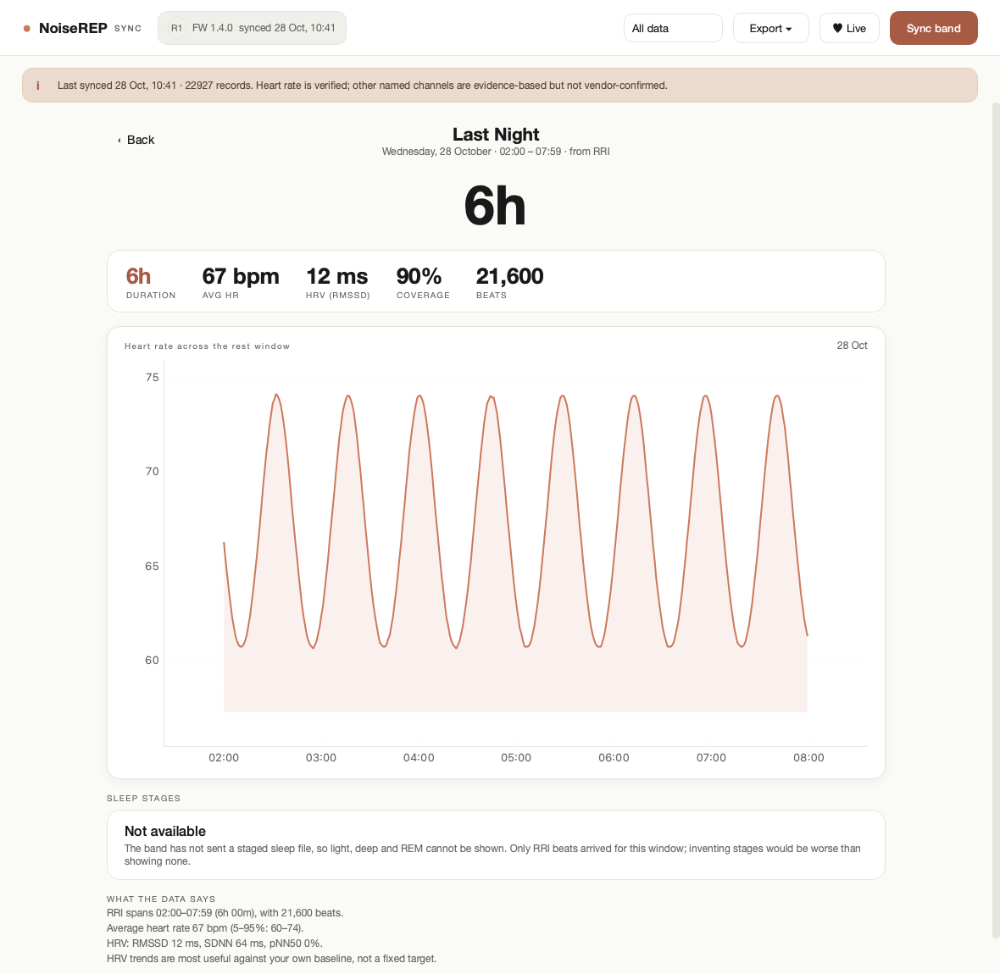
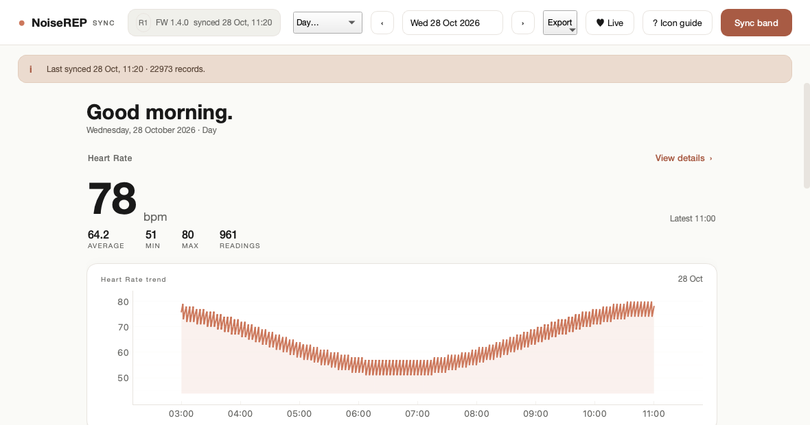

<p align="center">
  
</p>

<h1 align="center">OpenNoiseRep</h1>
<p align="center">Your Noise REP band's data, without the vendor app.</p>

<p align="center">
  
  
  
</p>

OpenNoiseRep connects to the band over BLE, syncs its history, stores it in
SQLite, and shows it in a desktop app, a menu-bar heart rate, and a CLI. The
Python package and command are still named `noiserep`.

## Screenshots

| Today | Sleep |
|---|---|
|  |  |

| Day navigation | Menu bar |
|---|---|
|  |  |

## Features

- Historical sync: device info, data index, heart-rate/activity series and
  pushed activity files.
- Desktop app: vitals, sleep, heart/stress, movement goals, charts and export.
- Day picker with calendar and previous/next day, plus 7-day, 30-day, all-data
  and custom ranges.
- Menu-bar heart rate: `♥ 72` worn, `♥ ~` off-wrist, `♥ —` disconnected.
  Optional walk-away lock.
- RRI/HRV rest summaries: duration, average HR, RMSSD/SDNN/pNN50 and coverage.
- Steps, distance, active calories and active minutes.
- CSV/JSON export and offline `.pklg` decoding.

## Install

```sh
python -m venv venv && . venv/bin/activate
pip install -e '.[ble,gui]'
```

Python 3.10+.

## Use

```sh
noiserep sync                      # fetch history
noiserep gui                       # desktop app
noiserep menubar                   # live heart rate in the menu bar
noiserep sleep                     # last night's rest summary
noiserep workouts                  # workout files, when present
noiserep export --format csv --out all.csv
noiserep decode capture.pklg       # offline
```

The band accepts one BLE central at a time. Wake it (or put it on the charger)
and turn the phone's Bluetooth off while syncing.

## Docs

- [Protocol notes](docs/PROTOCOL.md)
- [RRI and sleep file formats](docs/FILES.md)
- [Roadmap](docs/ROADMAP.md)
- [Release notes and data caveats](docs/RELEASE-NOTES.md)

## License

MIT — see [LICENSE](LICENSE).
