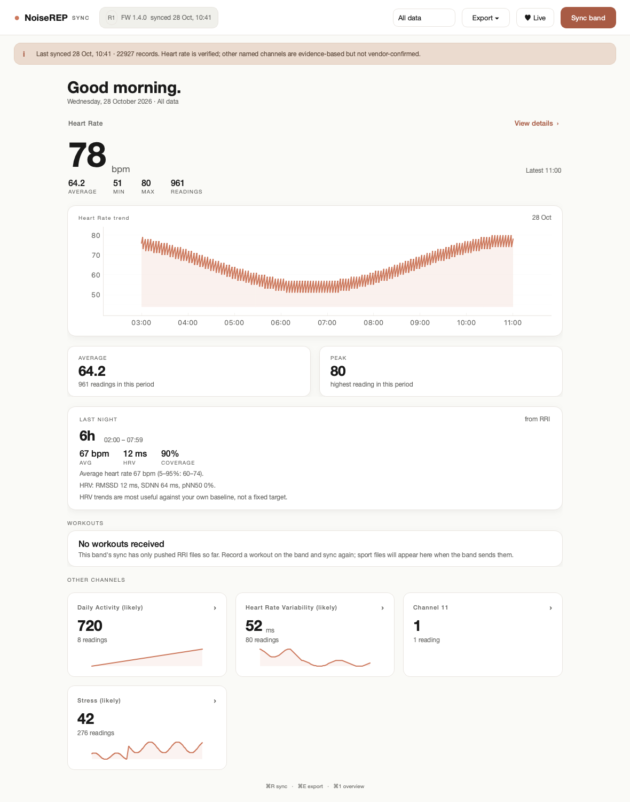
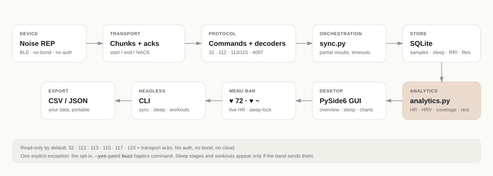

<p align="center">
  
</p>

<h1 align="center">noiserep</h1>
<p align="center"><b>Your Noise REP band's data — without the vendor app.</b></p>

<p align="center">
  
  
  
  
  
</p>

noiserep connects to the **Noise REP** fitness band over BLE, reads the history it
already stores, decodes it, and gives you a desktop app, a live menu-bar heart
rate, a CLI, and CSV/JSON exports. No account. No cloud. No vendor app.

> **Read-only by default.** The allowed traffic is the historical-fetch set
> (`32`, `112`, `113`, `115`, `117`, `123`) plus the transport acks. No auth, no
> BLE bond, no settings writes, no time-sync. The one explicit exception is the
> opt-in, `--yes`-gated `buzz` haptics command; sync and the GUI never call it.

## See it

| Today | Sleep & recovery |
|---|---|
|  |  |

| All channels | Live menu-bar states |
|---|---|
|  |  |

The screenshots are generated from **synthetic data** by
`tools/make_readme_images.py`; they contain no personal health data.

## What you get

- **Historical sync.** Scan by advertised name (`Noise_REP_*`), fetch device
  info, the data index, the `113`/`115` series and the pushed `4097` activity
  files. Chunking, start/end acks and auto-discovery work live.
- **A clean desktop app.** A health-style overview, per-channel charts, date
  ranges, sleep/rest detail, CSV/JSON export and a **♥ Live** button for the
  menu bar.
- **Live heart rate in the menu bar.** `♥ 72` when worn, `♥ ~` when the band is
  off-wrist, `♥ —` when disconnected. It tries the realtime stream and falls
  back to the confirmed `113` series.
- **Walk-away lock (opt-in).** If the band disconnects and does not return
  within a grace period, noiserep can lock the Mac locally.
- **Rest/sleep analytics.** Overnight RRI becomes a rest window with average and
  5–95% heart rate, RMSSD/SDNN/pNN50, beat coverage, a minute-level timeline and
  plain-language observations. It is labelled **from RRI**, never as scored sleep.
- **Workouts, when the band sends them.** Sport/workout files are detected and
  listed; today this band has sent none, and the UI says so.
- **Own your data.** SQLite storage with idempotent upserts, CSV/JSON export,
  and offline `.pklg` decoding with no hardware.

## Quick start

```sh
python -m venv venv && . venv/bin/activate
pip install -e '.[ble,gui]'        # live sync + desktop + menu bar
```

Then, with the band awake and nearby and **the phone's Bluetooth off** (the band
accepts one central):

```sh
noiserep sync                      # fetch the whole device timeline
noiserep gui                       # desktop app
noiserep menubar [--lock-on-away]  # live HR in the menu bar
noiserep sleep [--json out.json]   # headless rest summary + insights
noiserep workouts                  # list sport files, or explain that none arrived
```

Offline, with no band:

```sh
noiserep decode path/to/capture.pklg
noiserep decode path/to/capture.pklg --json out.json
```

Install only what you need: `.[dev]` (pytest), `.[ble]` (bleak), `.[gui]`
(PySide6, pyqtgraph, qasync). The headless core has no third-party runtime
dependencies. Python 3.10+.

## How it works

<p align="center">
  
</p>

Layers, from the wire up:

- **`wire.py`** — a small protobuf field reader/writer. Decoding walks raw fields
  because this band overloads Xiaomi's message shapes.
- **`protocol/`** — byte-exact command builders, payload decoders, metric
  evidence, RRI/sleep file decoders, experimental realtime builders and the
  isolated haptics module.
- **`ble/`** — chunking and start/end acks, scan/connect with lazy `bleak`.
- **`sync.py`** — the confirmed choreography; transport- and UI-agnostic.
- **`store/`** — SQLite: samples, activity files, sleep sessions/stages, RRI.
- **`analytics.py`** — rest windows, HR/HRV/coverage, non-medical insights.
- **`gui/`** — PySide6 desktop app and the `QSystemTrayIcon` menu bar.
- **`cli.py`** — `decode`, `sync`, `export`, `gui`, `menubar`, `sleep`,
  `workouts`, `buzz`.

See [`docs/PROTOCOL.md`](docs/PROTOCOL.md) for the wire format and
[`docs/FILES.md`](docs/FILES.md) for RRI/sleep layouts.

## Honest about the data

- **Heart rate is verified.** Daily activity, SpO2, HRV, stress and RRI are
  marked **likely** and shown with a `(likely)` suffix. Unknown ids stay
  `Channel N` forever; the neutral fallback is a feature.
- **Sleep stages need a staged sleep file.** Your band has sent only RRI, so
  light/deep/REM are not present. The app says *Not available* rather than
  inventing stages. A stage timeline renders automatically if the band sends a
  staged file.
- **No workouts have arrived.** The sync has only pushed RRI files. Record a
  workout on the band and sync again; sport files will appear if the band sends
  them.
- **The RRI millisecond unit is inferred**, validated against a vendor capture
  but not against the band's own readout.
- **The clock may be unset (~2002)** on a freshly-unpaired band. Sync defaults to
  the whole device timeline, and timestamps are device-relative.

This is an alpha, not a medical device. Values are raw sensor readings.

## Privacy & safety

- No network access, no account, no telemetry. Everything stays on your machine.
- The database lives in the per-OS user-data directory
  (`~/Library/Application Support/noiserep/` on macOS,
  `~/.local/share/noiserep/` on Linux); `--db` overrides it.
- `data/`, exports, `.pklg` captures and the DB contain **health data**; captures
  also contain the band **MAC and serial**. Never commit or share them.
- `noiserep buzz` is the only write path. It requires `--yes`, is isolated from
  sync/GUI, and is hardware-unverified.

## Status & roadmap

Phases 0–3 are implemented: offline decoders, live historical sync, store/export
and the desktop app. CI, a PyInstaller build script, issue forms and a security
policy are in place; signed binaries and a public release are not.

Hardware validation is still open for realtime HR, haptics, staged sleep, workout
files and the packaged app. See [`docs/ROADMAP.md`](docs/ROADMAP.md) and the
[`docs/SPEC-REVIEW.md`](docs/SPEC-REVIEW.md) for the gap analysis.

## Contributing

Protocol findings, decoders and UX work are welcome. See
[`CONTRIBUTING.md`](CONTRIBUTING.md). Run the no-hardware checks with:

```sh
./venv/bin/python -m pytest -q
./venv/bin/python tools/check.py      # or: make check
```

Never include a real MAC, serial or health value in an issue, test or screenshot.

## License

MIT — see [`LICENSE`](LICENSE). This project ships no Gadgetbridge-derived code;
Gadgetbridge was a reference for the transport layer only.
